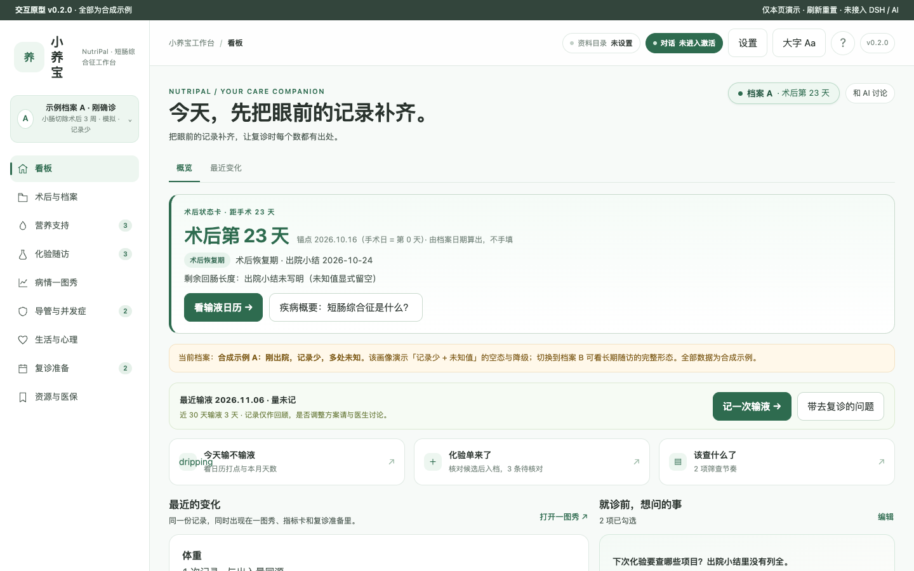
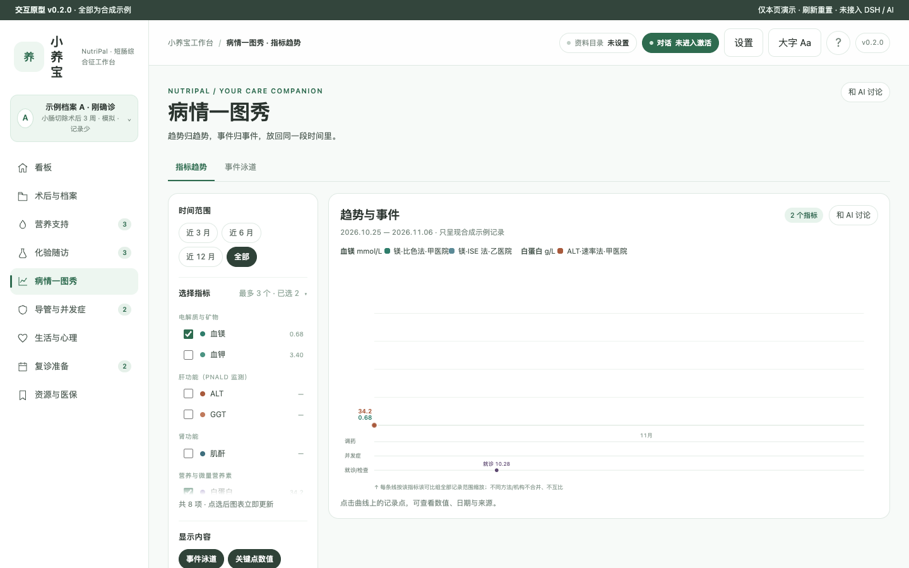
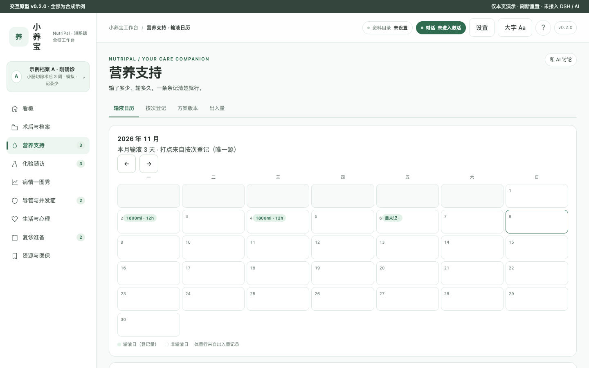
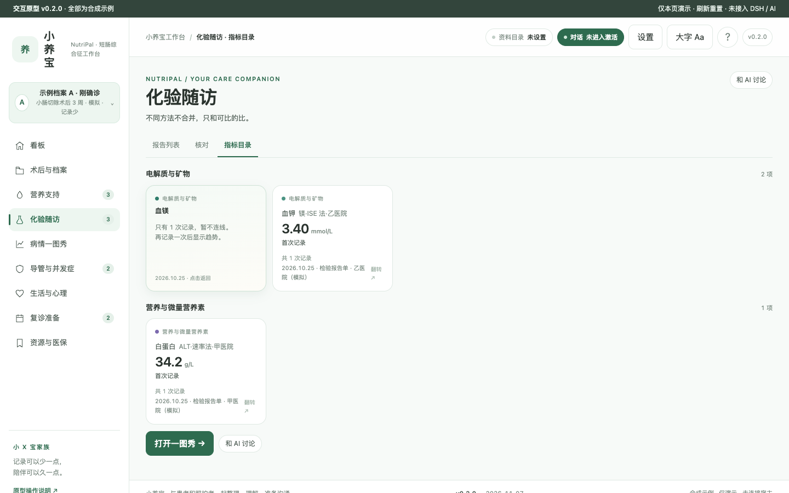
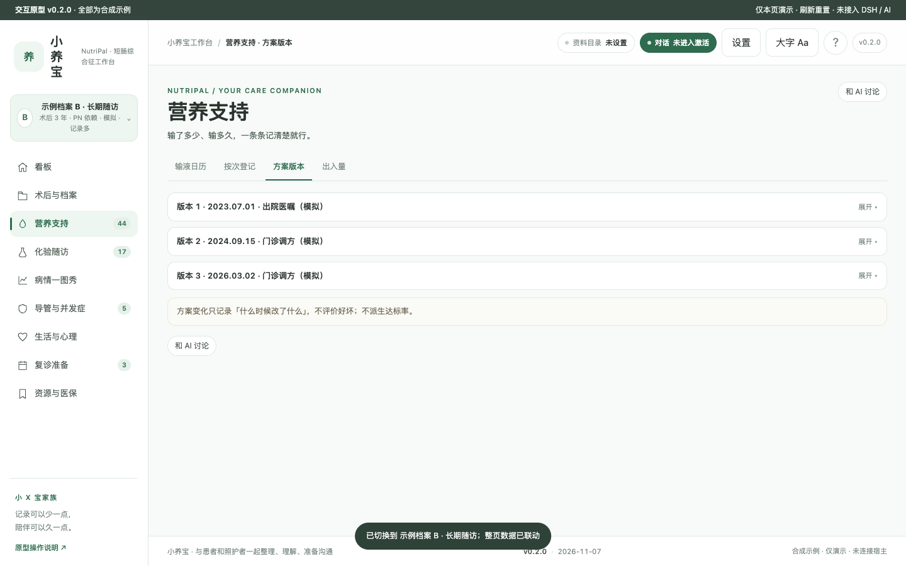
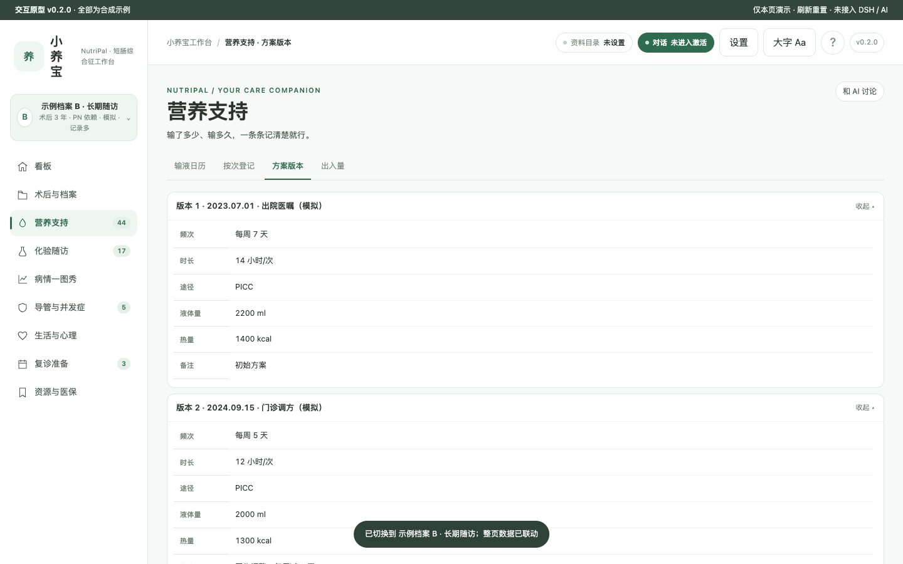
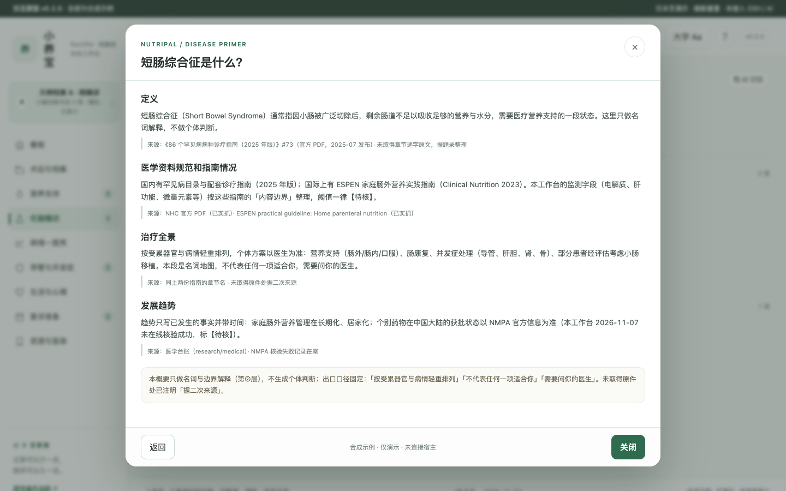
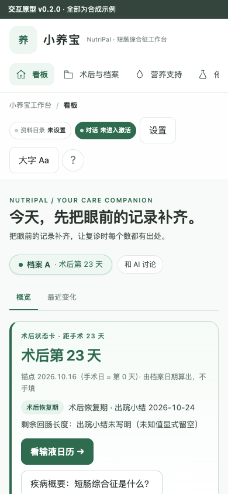

# 小养宝 NutriPal · 短肠综合征工作台

 

短肠综合征（SBS，罕见病 #73 · R2 · T2）患者的本机优先工作台：营养支持登记与输液日历、化验随访（不同方法不合并）、中心静脉导管与并发症筛查、生活与心理、复诊准备。认领记录：[Issue #65](https://github.com/xyb-openharness-dsh-plugins/.github/issues/65)。

> 品牌占位名：小养宝 NutriPal。0 患者访谈、0 临床审核（2026-11-07），全部如实标注。

## 疾病概要

短肠综合征通常指小肠被广泛切除后，剩余肠道不足以吸收足够营养与水分，需要医疗营养支持的一段状态。国内有《86 个罕见病病种诊疗指南（2025 年版）》#73 与 ESPEN 家庭肠外营养指南（2023）作为内容边界。本工作台只做事实记录与整理（第②层解释），不做个体判断；治疗全景按受累器官与病情轻重排列，不代表任何一项适合你，需要问你的医生。

### 定义

短肠综合征（Short Bowel Syndrome）通常指因小肠被广泛切除后，剩余肠道不足以吸收足够的营养与水分，需要医疗营养支持的一段状态。这里只做名词解释，不做个体判断（来源：《86 个罕见病病种诊疗指南（2025 年版）》#73 · 未取得章节逐字原文，据题录整理）。

### 医学资料规范和指南情况

国内有罕见病目录与配套诊疗指南（2025 年版）；国际上有 ESPEN 家庭肠外营养实践指南（Clinical Nutrition 2023）。本工作台的监测字段（电解质、肝功能、微量元素等）按这些指南的「内容边界」整理，阈值一律【待核】。

### 目前治疗全景概要

按受累器官与病情轻重排列，个体方案以医生为准：营养支持（肠外/肠内/口服）、肠康复、并发症处理（导管、肝胆、肾、骨）、部分患者经评估考虑小肠移植。本段是名词地图，不代表任何一项适合你，需要问你的医生。

### 发展趋势

趋势只写已发生的事实并带时间：家庭肠外营养管理在长期化、居家化；个别药物在中国大陆的获批状态以 NMPA 官方信息为准（本工作台 2026-11-07 未在线核验成功，标【待核】）。

## 关键功能（合成示例截图）

全部数据为两套合成示例档案（A 刚确诊记录少 / B 长期随访记录多），顶栏切换、整页联动。


*看板首屏：术后第 N 天由档案日期算出，不手填；右侧是就诊前想问的事。*


*不同方法/机构的化验分线不合并；调药、并发症、就诊各占一条泳道。*


*输液日/非输液日的月历打点；打点、登记表、一图秀读同一份数据。*


*翻面不改变栅格高度；差值只写「较前次」，跨可比组不做差。*


*营养方案按版本折叠；更正 = 新增版本，旧版本永远可查。*


*展开后可见频次/时长/途径/液体量/热量，未记录的字段显式「未知」。*


*定义 → 指南情况 → 治疗全景 → 发展趋势；未取得原件处注明「据二次来源」。*


*三档断点 1180/900/600；390 宽实测 scrollWidth = 390。*

## 怎么用

- 原型：直接用浏览器打开 `prototypes/v0.2/index.html`（全部为合成示例，刷新重置）。
- 开发版 v0.2.1 已装入 DSH Desktop（宿主清单已加载、路由 401 鉴权先行）；真机业务走查待用户新建会话（见 docs/signoffs/V2V3-自动签认.md）。

## 数据与口径

- 演示数据唯一源：`prototypes/v0.2/demo-data.js`（两套档案 A/B，覆盖零条/单条/多条/缺字段/未知日期/私密项/无原件）。
- 私密三出口（看板摘要/导出/AI 上下文）共用同一过滤函数，界面显示「N 条中私密 M 条」。
- 化验按「指标 + 方法 + 机构」可比组连线，跨组不连线不做差；阈值与间隔一律【待核】。
- 无诊断、无判定列、无风险评分；派生值读时算不落库。

## 开发

```bash
npm install
npm run check          # 检查链（含版本同源 / 文案红线 / 冻结合同 / 双形态 ui-parity 测试）
npm test               # 测试（8 个用例文件）
npm run audit          # 一致性审计
npm run dev -- --workspace <你选定的资料目录>   # M5 开发版：本机服务 + public/ 界面（默认 http://127.0.0.1:4173）
node scripts/probe-prototype.mjs   # 原型探针（需要本机 Chrome）
```

M5 起有开发版客户端链路：`src/client.js`（customFrame 外壳）→ `npm run build:client` 生成 `lib/client.js`；
接口前缀 `/api/short-bowel`（两条链路共用 `dsh/routes.js`）；页面在 `public/`，与 `prototypes/v0.2`
的差异只允许在 `DEV-BRIDGE` 注释对里（test/ui-parity.test.mjs 机械保证）。

- 里程碑与闸口：docs/DEV-PLAN.md；闸口签认：docs/signoffs/。
- 原型检查点逐条实测：docs/PROTOTYPE-CHECKLIST.md。
- 版本：仓库根 VERSION 文件为唯一来源；顶栏/页脚/关于弹窗同源渲染。
